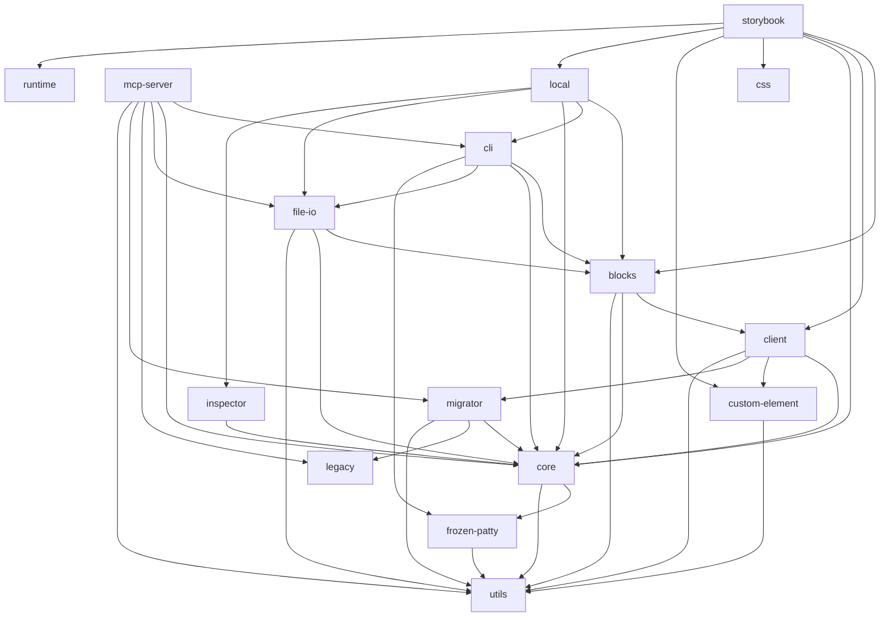

# BurgerEditor v4 アーキテクチャ索引

この文書は**索引**であり、実装の解説ではない。目的は「どこを、どの順で読めばよいか」を絞り込むことにある。実装詳細の正は各ソースの JSDoc、パッケージの使い方の正は各パッケージの README。コードはファイルへのリンクではなく**シンボル名**で示すので、エディタのシンボル検索や`git grep`で辿ること。

この文書と実装が矛盾していたら、実装詳細の矛盾は実装を正としてこの文書を直す。依存の向きや不変条件との矛盾は、実装が設計違反をしていないかを先に調べる。

## 全体地図

BurgerEditor は CMS に埋め込む HTML ブロックエディタ。UI を持たない headless な`core`を中心に、ブラウザ側（React UI・TipTap の Web Components）と Node.js 側（ファイル I/O・CLI・ローカル CMS・MCP サーバー）が分かれている。

| パッケージ       | 実行環境      | 何があるか                                                                                              |
| ---------------- | ------------- | ------------------------------------------------------------------------------------------------------- |
| `utils`          | 共通          | 日付・Markdown 変換などの汎用関数                                                                       |
| `frozen-patty`   | 共通          | `data-*`属性で HTML とデータを相互変換する（テンプレートエンジンなし）                                  |
| `core`           | ブラウザ/Node | エディタエンジン`BurgerEditorEngine`、ブロック・アイテムのモデル、UI 状態ストア、コマンドバス           |
| `custom-element` | ブラウザ      | TipTap による`<bge-wysiwyg>` / `<bge-wysiwyg-editor>`                                                   |
| `client`         | ブラウザ      | `core`の UI を React で実装したもの。`client/ui`でアイテムエディタ用の部品を公開                        |
| `blocks`         | ブラウザ/Node | 標準アイテムとカタログ。ルートエントリ（Node でも読める）と`blocks/editor`（ブラウザ専用）の 2 つの入口 |
| `migrator`       | ブラウザ/Node | v3 のコンテンツを v4 へ移行する                                                                         |
| `legacy`         | 共通          | v3 互換のための定義                                                                                     |
| `inspector`      | Node          | 保存済み HTML の検査・CSS 変数の検索                                                                    |
| `file-io`        | Node          | 設定ファイルの解決、ページの読み書き、仮想パスの解決、Node で`core`を動かすための DOM                   |
| `cli`            | Node          | AI エージェント向けの JSON 出力 CLI と、エージェント向けツールの定義                                    |
| `local`          | Node+ブラウザ | ローカルファイルを編集する CMS（`bge`コマンド）と、ブラウザへ編集を届ける Agent Hub                     |
| `mcp-server`     | Node          | MCP サーバー（`bge-mcp-server`）。v3 互換ツールと`cli`のエージェント向けツールを登録する                |
| `css`            | 配布物        | `blocks`の CSS をまとめて配布する                                                                       |
| `runtime`        | ブラウザ      | 公開ページ側で動くランタイム（画像モーダル・カルーセル）。他のどのパッケージにも依存しない              |
| `storybook`      | 開発用        | 管理画面 UI と公開ページ表示のカタログ（private。他のパッケージから依存されない末端）                   |

## 境界と所有権

1 つの概念を持つのは 1 か所だけ。他のパッケージはそれを使うだけで、同じものを自前で持たない。

- **エンジンと UI の接点は`core`が定義し、`client`が実装する。**
  - `core`は UI フレームワークを知らない。UI に求めるのは`BurgerEditorView`（編集エリアごとのホストを作る`createAreaHost()`）だけ。`core`は返された`containerElement`の中身しか触らない。
  - 「どのダイアログが開いているか」「処理中か」「ソース編集中か」は`engine.uiState`（`UIStateStore`）が持つ。UI はそれを購読して描画するだけで、`core`から UI を命令的に呼ぶ経路はない。
  - React 実装は`client`の`createReactView()`。`engine.viewArea`配下の React root は 1 つで、編集エリアやダイアログはそこから portal で描く。例外は`attachDraftSwitcher()`で、ホスト側の好きな位置に置けるよう独立した root を持つ。
- **エンジンを動かすのはコマンドだけ。** 語彙は`core`（`BGE_COMMAND`）、ディスパッチ表は`client`の`registerEngineCommands()`。ボタンは`command`/`commandfor`属性でコマンドバスを指す。
- **アイテムの契約は`core`の`createItem()`。** 定義（テンプレート・`toEditorState`/`toItemData`）は React に依存せず、編集 UI の`Editor`だけが React に依存する。`blocks`はこの 2 つを別ファイルに分けて、ルートエントリから React を外している。`toItemData`は throw して確定を拒める（ダイアログは開いたまま理由を表示する）。この検査は編集画面の経路だけが持つ。
- **`BlockOp`（ブロック操作）の型は`core`が持つ。** `cli`の`blockOpSchema`はそれを検証するだけ。
- **Front Matter のパーサは`core`が持つ。** `file-io`と`local`はそれを使う。
- **ファイルシステム・設定・パスの解釈は`file-io`だけが持つ。** `local`/`cli`/`mcp-server`が同じ`resolveConfig()`と`resolvePathInput()`を通るので、ブラウザから編集しても AI エージェントから編集しても結果が同じになる。
- **AI エージェント向けツールの定義は`cli`の`agentTools`だけが持つ。** `mcp-server`と`local`の Agent Hub は、この配列を登録するだけ。
- **`local`の仮想ファイルツリーの状態は`createResolverStateStore()`だけが持つ。** ルートは`AppContext`経由で受け取り、自前で状態を持たない。

## 依存の向き

依存してよいのは上の図の矢印だけ。新しい矢印を足すときは、図も同じ変更で直す（`yarn verify:architecture-graph`が package.json との食い違いを CI で落とす）。図は`dependencies`/`peerDependencies`だけを描く。`devDependencies`は図に描かないが、図の向きを逆流させるもの（ビルド順が循環するもの）は同じスクリプトが落とす。モノレポ内でも、他のパッケージへは`package.json`の`exports`経由でしかアクセスしない。

次の依存は「無いこと」に意味がある。

- **`core`は React・UI・Node のファイル I/O に依存しない。** どの CMS・どの UI でも使えるようにするため。`core`から`cli`/`blocks`/`client`への矢印も作らない。
- **Node 側のコードは`blocks`のルートエントリだけを import する。** `file-io`/`cli`/`mcp-server`とユーザーの`burgereditor.config.js`が対象。`blocks/editor`や`client/ui`を読むと`react`が必要になり、React を入れていない環境で起動時に落ちる。モノレポ内ではルートに React があるため、普通のテストでは再現しない。`blocks`側は、ルートエントリが React に届かないことを ESLint の`no-restricted-imports`と`yarn verify:blocks-boundary`で守っている。Node 側のパッケージが`blocks/editor`などを import していないかは ESLint では検査しておらず、build 後の`yarn verify:packed-install`と`cli`の`bin.spec.ts`で検出する。
- **`local`のブラウザ側コードは`cli`を`@burger-editor/cli/block-op`からしか import しない。** メインエントリは`node:fs`などを引き込み、ブラウザ向けのビルドを壊す。
- **`runtime`と`legacy`はどのパッケージにも依存しない。** `runtime`は公開ページで単独で読み込まれるため。

## 不変条件と負の知識

コードを読んでも「なぜそう書いてはいけないか」がわかりにくい制約。詳しい理由は、挙げたシンボルの JSDoc にある。

- **`local`のブラウザバンドルには`core`が 2 つ入っている。** `client`の dist に inline されたものと、直接 import されたもの。`BurgerBlock`/`Item`の登録表はモジュール単位の状態なので、片方からもう片方のブロックは見えない。ブラウザ側コードは稼働中のブロックに対して、`core`の関数ではなくエンジンのメソッド（`engine.getLiveBlocks()`/`engine.applyLiveBlockOp()`）を呼ぶ。コマンドバスの`receiverId`の連番も、同じ理由でモジュールのコピーごとにしか一意でない。
- **1 つの document に複数のエンジンを置ける。** document 全体で固定の ID は使わず、エンジンごとの ID（`engine.commandBus.receiverId`、ダイアログの`useId()`）を使う。逆に、`<bge-wysiwyg-editor>`の`classList`・テキスト編集モードの設定・Google Maps の script・ブロックのクリップボード（`sessionStorage`）は、意図して document 単位で共有している。
- **クリックイベントは使わない。** `onClick`・`addEventListener('click')`・`click()`は ESLint で禁止している。ボタンの動作は Invoker Commands（`command`/`commandfor`）で宣言する。エンジンを動かすコマンドはエンジンのコマンドバスを、表示だけを変えるコマンドはコンポーネント自身を指し、`useCommand()`で受け取る。
- **`engine`は props で渡さない。** 配下のコンポーネントは`useEngine()`で読む。アイテムの`Editor`の props も`{ state, setState, item }`だけ。
- **`createItem()`の戻り値はスプレッドできない。** テスト用の getter（`_`）が throw する。合成するときは、`createItem()`に通す前の素の定義オブジェクトを使う。
- **React Compiler は、オブジェクトのメソッド省略記法で書いたコンポーネントを黙って対象から外す。** アイテムの`Editor`は`editor.tsx`に名前付きの関数として定義する。`eslint-disable-next-line react-hooks/exhaustive-deps`を書くと、そのコンポーネント全体が対象外になる（`useMountEffect()`や`useEffectEvent`で避ける）。`yarn verify:react-compiler`が、アイテムごとに期待するコンパイル状態を CI で検査している。`BGE_NO_COMPILER=1`を付けるとコンパイラなしでビルド・テストできる。
- **`readToken`はセキュリティ境界ではない。** 「読んでから書く」という手順を強制するための、内容のハッシュに結び付いたトークンで、偽造は防がない。パスのセキュリティ境界は`resolvePathInput()`の documentRoot 封じ込め（`PathOutsideDocumentRootError`）。
- **公開ページでの carousel の動作は、blocks の CSS と runtime の JS で分担する。** 保存 HTML の形と、runtime が実行時に付ける`data-bge-carousel-*`属性の取り決めは blocks の`carousel`（`style.css`と`definition.ts`）が持ち、runtime はそれに従う。runtime はどのパッケージにも依存しないので、取り決めは型ではなく、runtime のテストが本物のテンプレートと`@burger-editor/css`で検査する。値を 2 か所に持たない（表示枚数は`style`の`--per-view`だけ）。エージェント経由の保存は`toItemData`を通らないため、2 か所に持つと食い違う。同じ理由で、スライドの名前（キャプションか alt）とリンク・ポップアップの alt が必須という検査も`toItemData`にあり、エージェント経由の保存や保存済みの HTML は検査されない（名前の無いスライドの代わりの名前は runtime が付ける）。
- **`local`のルートは、すべて認証の内側に置く。** `createApp()`は全ルートの前に`hostGuard`（DNS rebinding 対策）→ `tokenLogin` → `requireAuth`（ループバック以外で待ち受けるときは認証必須）を掛ける。このゲートを素通りするのは`/api/health`（何も公開しない）と、自前で認証する`/api/agent/*`・`/ws/*`だけ。この 2 つの配下にルートを足すときは自分で認証する。ゲートの認証は Agent Hub を無効にしても有効なまま。

## 変更の種類ごとの読み方

| 変えたいもの                   | 読む順番                                                                                                                                                                                      |
| ------------------------------ | --------------------------------------------------------------------------------------------------------------------------------------------------------------------------------------------- |
| 標準アイテム（ブロックの部品） | `blocks/src/items/<name>/`の`definition.ts` → `editor.tsx` → `index.tsx` → `core`の`createItem()` → 使う部品の`client/ui`。カタログは`blocks/src/catalogs/`                                   |
| WYSIWYG の書式・ツールバー     | Skill `.claude/skills/tiptap-extension/`                                                                                                                                                      |
| エンジンの操作・ボタン         | `core`の`BGE_COMMAND` → `client`の`registerEngineCommands()` → ボタンを置くコンポーネント                                                                                                     |
| ダイアログや表示状態           | `core`の`UIStateStore`（`engine.uiState`）→ `client`の`BurgerEditorRoot`                                                                                                                      |
| 設定項目（`Config`）           | `core`の`Config` → `file-io`の`resolveConfig()`。試験的な項目は`Config.experimental`の JSDoc に従う                                                                                           |
| AI エージェント向けツール      | `cli/src/agent-tools/tools/` → `agentTools` → `readToken`の契約（`read-token.ts`）。`mcp-server`と`local`は自動で拾う。Agent Hub の契約は`local`の README、仕組みは`local/src/agent/`の JSDoc |
| `local`の HTTP ルート          | `local`の`createApp()` → `AppContext` → `routes/`。テストは`app.request()`か`hono/testing`の`testClient`                                                                                      |
| 仮想ファイルツリー             | `local/docs/virtual-tree.md` → `file-io`の`virtual-path-resolver.ts` → `local`の`createResolverStateStore()`                                                                                  |
| v3 互換・移行                  | `legacy` → `migrator` → `mcp-server`の v3 ツール                                                                                                                                              |
| パッケージ間の依存             | 該当する`package.json` → この文書の図 → `CLAUDE.md`の「依存関係の追加」                                                                                                                       |
| テストプロジェクト             | `vitest.config.ts` → `scripts/vitest-project-groups.js`（登録しないと設定の読み込みで失敗する）                                                                                               |
| 公開ページの動作（carousel）   | `blocks/src/items/carousel/`の`template.html` → `style.css` → `runtime/src/carousel/`。見た目と操作は Storybook の`Public/Carousel`で確かめる                                                 |

## テスト

- テストは Vitest。プロジェクトごとの実行環境（Node/jsdom/Playwright の Chromium）と対象は`vitest.config.ts`が正。iframe の`contentWindow`のように実ブラウザの API が要るものだけをブラウザで動かす。
- 見た目の回帰は`client`の`*.vr.spec.ts`（`vr`プロジェクト）がスクリーンショットで検出する。CI と画素単位で一致させるため、Docker の中で実行する。
- 公開物としての正しさは、ビルド後の検査が守る。`verify:blocks-boundary`（ルートエントリに React が混ざらない）、`verify:packed-install`（`yarn pack`した tarball を React なしの環境に入れて`cli`/`bge`/`bge-mcp-server`を起動）、`verify:react-compiler`、`verify:architecture-graph`。
